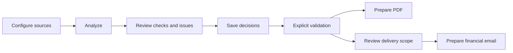

# CS-Manager

**Contract management, timesheet validation and financial monitoring in a standalone browser application.**

Current documented release: **2.7.3** — see the [changelog](docs/CHANGELOG.md).

CS-Manager brings contract information, resource allocation, monthly timesheet review and financial delivery preparation into a single workspace. It reads selected Excel workbooks locally in the browser and stores review decisions in an annual JSON archive.

## Features

| Area | Capabilities |
| --- | --- |
| Contracts | Browse, create and edit contracts; review resources, planned hours, rates, budget and FTU. |
| Profiles and rates | Search and filter resources, contractors, project managers and contractual rates. |
| Timesheet review | Analyse monthly Excel files, including Standard and V2 formats; check contract associations, hours, totals, periods, saved formula values and potential duplicates. |
| Timesheet details | Review checks, issues, spreadsheet previews and revision history; record comments, accept anomalies, explicitly validate or exclude a document. |
| PDF preparation | Print saved, validated timesheets with a suggested filename derived from the original Excel filename. |
| Contract consumption | Review monthly and cumulative costs, remaining budget and estimated consumption trends. |
| Delivery | Review monthly costs by PO, CS and profile; prepare an editable financial email draft. |
| Settings and diagnostics | Configure data sources, inspect the analysis log and consult the built-in guide. |

The interface supports English, French and Italian, light and dark themes, and a collapsible sidebar.

## Quick start

1. Obtain the complete distribution folder from this repository.
2. Open `index.html` in a recent version of Google Chrome or Microsoft Edge.
3. In **Settings**, select the contract workbook and the annual timesheet folder. A blank workbook template can be downloaded from Settings.
4. Grant the required browser permissions and select **Analyze**.
5. Review individual timesheets, save decisions and explicitly validate eligible documents.
6. Use **Contract consumption** and **Delivery** to review costs and prepare monthly reporting.

No mandatory backend or software installation is required for the normal browser workflow. Browser policies and filesystem permissions may affect local file access.

For setup and troubleshooting, read [Installation](INSTALLATION.md) and the [User guide](docs/USER_GUIDE.md).

## Data requirements

The Excel master workbook must contain:

- `Contracts`
- `Persone e tariffe PO`
- `Calendar` — required for timesheet validation: `Date` and `Hours` columns, one row per calendar day, including zero-hour closures.

The annual timesheet directory uses monthly folders named `01` through `12`. Review decisions are stored in `CS-Manager-controls.json` at the annual directory level. Legacy control files can be imported and retained as backups.

Production workbooks, personnel data, timesheets and validation archives are not intended to be distributed through this repository.

## Monthly workflow



Saving checks does not automatically validate a timesheet. Browser PDF printing requires a saved validation. Cost eligibility and delivery readiness are distinct from validation status.

The suggested PDF filename preserves the original Excel basename and appends `-VALIDATED.pdf`.

## Architecture and distribution

CS-Manager is distributed as a self-contained HTML application using embedded HTML, CSS and JavaScript. Selected Excel files are processed locally; browser filesystem access is used for supported workbook and archive updates. Optional Windows export helpers are supplied separately.

```text
CS-Manager/
├── index.html
├── INSTALLATION.md
├── README.md
├── docs/
│   ├── USER_GUIDE.md
│   └── CHANGELOG.md
├── data/
│   └── README.md
└── tools/
    ├── EXPORT_VALIDATED_TIMESHEET.cmd
    └── EXPORT_VALIDATED_TIMESHEET.ps1
```

## Operational limitations

- The application reads saved Excel formula values; it does not run Excel macros or recalculate formulas. Recalculate and save affected workbooks in Excel before relying on updated derived values.
- Month folders are checked, but the reporting year is read from the timesheet itself; an independent incorrect-year check is not currently available.
- Browser-generated PDFs may differ from Excel formatting. Review the A4 preview and source values before use.
- Email preparation does not automatically attach documents, verify PDF availability or confirm delivery.
- Financial projections depend on available source data and may be incomplete.
- Archive revision and hash checks do not guarantee safe simultaneous writes from different computers. Avoid concurrent editing and maintain backups.
- Browser support and organizational security policies may restrict filesystem access.

## Data protection

Use authorized storage locations and follow applicable organizational data-handling policies. Do not commit real workbooks, timesheets, financial rates, personal information, validation archives, credentials or internal infrastructure details to a public repository. Use synthetic data for demonstrations, testing and screenshots.

## Quality assurance and roadmap

Automated Node.js and Playwright regression tests run in GitHub Actions. The online demo uses fictional workbooks and a fictional working calendar; no institutional calendar or real personnel data is published. The demo supports TM monthly collection, PDF tracking and simulated manual DISP confirmations.

Report reproducible defects using anonymized examples. Include the application version, browser, expected behaviour and actual behaviour.

## Documentation

- [Installation and browser requirements](INSTALLATION.md)
- [User guide](docs/USER_GUIDE.md)
- [Release history](docs/CHANGELOG.md)
- [Data directory guidance](data/README.md)


## Visual EP calendar (2.2.0)

Open **EP Calendar** under monthly operations or use the calendar links in Delivery and Timesheet Detail. Navigate by month, inspect daily limits and annual totals. A zero-hour day is distinct from missing calendar data; incomplete periods do not display confirmed totals. Optional `Location` (`LU`, `BR`, `LU/BR`) and `Reason` columns in the Calendar sheet provide descriptive holiday labels only; the numeric `Hours` column remains authoritative. Red outlines identify analyzed, non-excluded timesheets exceeding a daily limit. Demo holidays are fictional. No external calendar or holiday lookup is performed.


## TM monthly collection (2.3.0)

In Delivery, select a month to view TM contracts and choose a CS/PO to inspect each expected person. Expected submissions use unique current person–CS–PO associations, excluding explicitly inactive resources, and contracts with verified date overlap and Active or Closed status. Unknown resource status and duplicate associations are flagged. Received means a matching analyzed file (including excluded files); duplicate files count once as received and do not qualify as validated. Missing means no matching analyzed file, not verified absence from a live folder. Reanalyze before using the counts. Historical roster assignments are unavailable; earlier months must be interpreted against the current roster. Financial confirmation for TM requires a complete unambiguous set of saved validations. PDF presence and DISP signatures remain manual checks. QTM/FP collection rules are not changed.


## PDF and DISP tracking (2.4.0)

In Delivery select a TM CS/PO and reporting month. After validating the timesheets, select the exact PDF folder with **Select PDF folder**. Files are checked by the expected `-VALIDATED.pdf` basename, PDF header and content hash, in that folder only; duplicate names are ambiguous. Verify the signature in DISP separately, then manually confirm each document in CS-Manager. Confirmations and revocations are saved with the reviewer, timestamp, PDF hash and source validation revision in the annual JSON archive. A changed PDF or validation requires a new confirmation. The PDF folder must be selected again after reload. TM financial draft preparation and opening require current PDF confirmations. A manual confirmation does not prove cryptographic validity or correspondence of PDF content to Excel; review both in DISP. DEMO uses fictional PDF placeholders, not signed documents. QTM/FP rules are unchanged.


## Financial delivery tracking (2.5.0)

In Delivery, select a TM contract and reporting month, verify the complete collection, saved validations, PDF presence and manual DISP confirmations. Enter the recipient, prepare the financial summary, and send the email through your usual client. After actually sending it, enter the actual date/time and select Confirm sent. The annual control archive records the declared sending date, reviewer, recipient, subject, total, summary hash and exact document revision references. The application does not verify that the email was sent, received or unchanged in the email client. Refresh history to see existing records. Revoke an incorrect record with a reason; prior events remain in the archive. QTM/FP workflow is unchanged. The DEMO only simulates this workflow and never sends actual emails.


## Timesheet calendar review (2.6.0)

Open Timesheet Detail, then Preview. The calendar displays the actual timesheet month and compares declared daily hours with EP calendar limits. Click a date for OS/NS/additional hours, review flags and source cell references. Click a cell reference to highlight its Excel preview cell. Use the issues-only filter to isolate anomalies, missing dates and unavailable calendar data. Blank hours and permitted below-limit hours are distinguished from missing date rows; neither automatically indicates a validation failure. Mixed OS/NS is a visual review flag; existing validation rules and archived control signatures remain unchanged. Local holidays require metadata in the master Calendar sheet. Unrecognized months and incomplete calendar data are explicitly flagged.


## Contract extensions (2.7.0)

Open a contract in **Contracts** and select **Clone for extension**. Review the new dates, budget and planned hours before using the extension. The clone starts as Pending under a generated `TMP-…` PO. The CS, descriptive fields and resources are copied, including profiles, rates and planned hours where available. Dates, budget and available balance start blank. The master workbook stores the new contract and roster rows in one save.

When the new PO is assigned, open the extension, select **Edit contract**, replace the temporary code with the final numeric PO and save. The app updates the extension and its resource associations together. Cloned resources use the roster and can be edited there. Integrate them into the definitive PO worksheet in Excel if you use worksheet formulas for balances or planning. Timesheets, financial history and the original PO worksheet are outside the clone.
